  

  
  

<h2 align="center">👨‍💻 Sobre mim</h2>

<h2 align="center">🧰 Tecnologias</h2>

    
    
  

<h2 align="center">🚀 Destaques</h2>

   
   

<h2 align="center">📊 Atividade</h2>

  
  

<h2 align="center">📌 Princípios</h2>

> **Produção é o único ambiente que importa** — tudo automatizado, observável e reversível.

| ✨ Simplicidade | 🔔 Observabilidade | 🔒 Segurança |
|:---:|:---:|:---:|
| Código simples e tipado vale mais que código esperto | Toda falha gera alerta — e, se possível, recuperação automática | Backup e segurança são pré-requisitos, não features |

